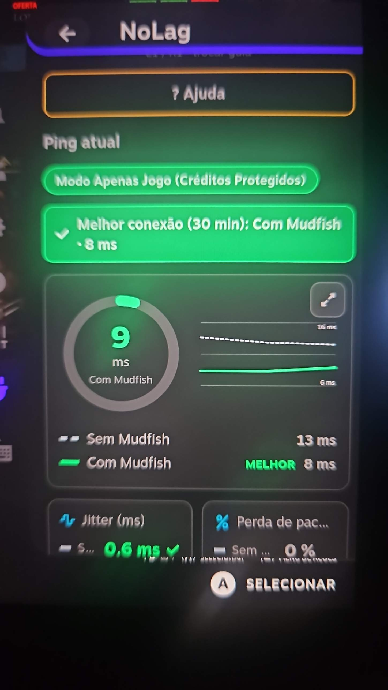
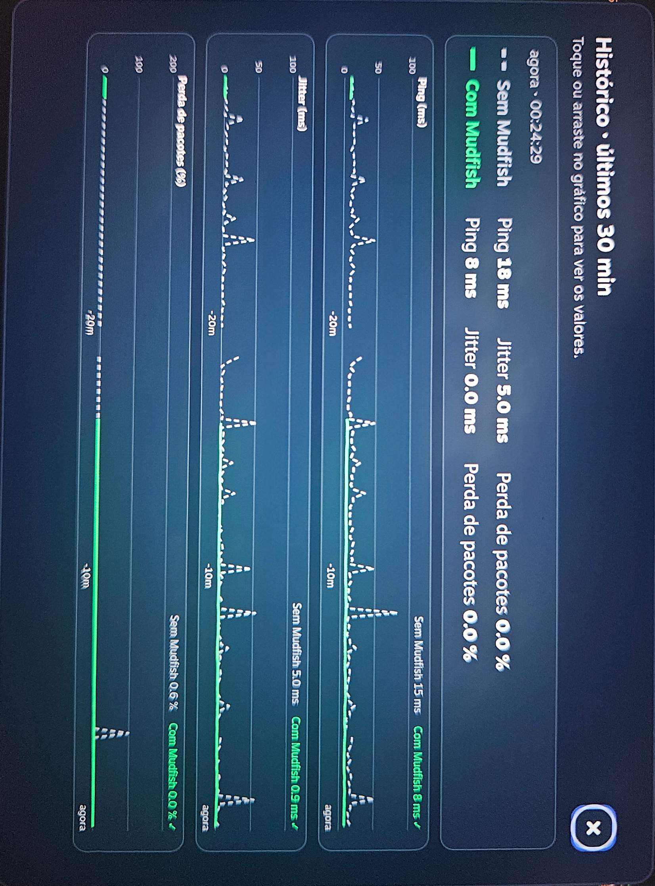
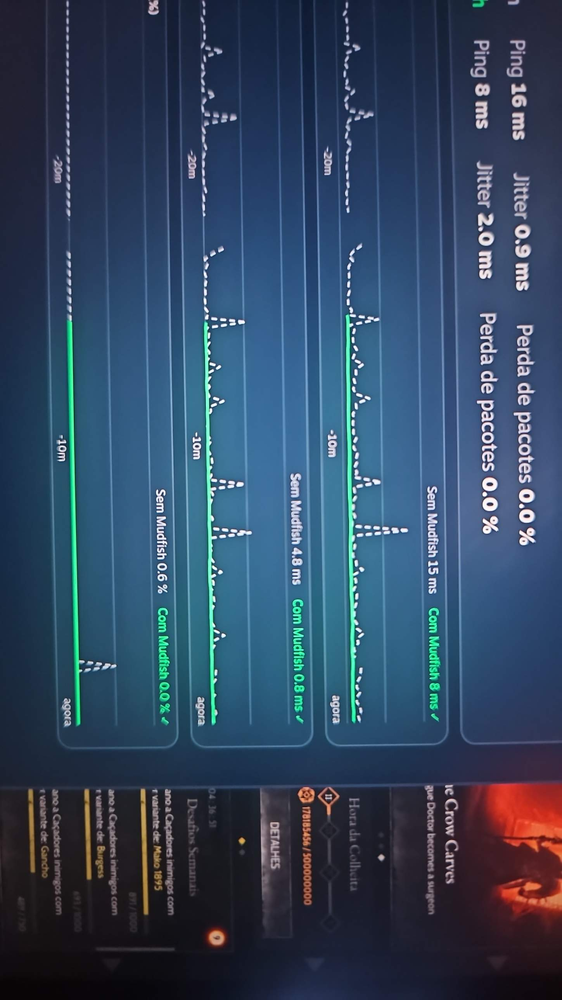

# 🎮 NoLag — Decky Loader Plugin (SteamOS / Bazzite)

Network access, monitoring and automation helper for **SteamOS**, **Steam Deck**, **Legion Go** and other handhelds compatible with **Decky Loader**.

The plugin has **two independent modules**, to keep control simple, predictable and safe:

- 📶 **Wi-Fi:** local network tweaks (based on *WiFi Optimizer*), isolated and persistent. They are not undone when you close games, reboot the console or turn Mudfish off.
- 🌐 **Mudfish:** manages the headless service (port `127.0.0.1:8282`), with real-time telemetry, 30-minute history, *Without Mudfish vs. With Mudfish* comparison, best-connection highlight and a browser picker for the web interface.

Languages: 🇧🇷 Portuguese · 🇺🇸 English · 🇪🇸 Spanish.

---

## 🔗 Third-party service (Mudfish)

- **Mudfish** is a third-party service and requires your own account and credits/plan.
- Official site: [mudfish.net](https://mudfish.net/) · Downloads: [mudfish.net/releases](https://mudfish.net/releases/)
- Login, game items, region, nodes and **Full VPN** are configured in the native panel: `http://127.0.0.1:8282`.

> ⚠️ **Note about version `5.xx`:** for now, the plugin may install or show the `5.xx` core base in some scenarios. **After updating the plugin/core, everything works normally.**

---

## 🧩 What each section does

### 📊 Dashboard
Current ping ring, *Without Mudfish* vs. *With Mudfish* comparison, **Jitter** and **Packet loss** mini-cards (✓ on the lower value), the **Best connection (30 min)** banner and an expand button for the full-screen history.

### 📶 Wi-Fi
Organized into *Quick actions*, *Optimizations*, *Streaming* and *Advanced*. Stabilizes the local connection without depending on Mudfish.

### 🌐 Mudfish
- 3-step status; install, update or **uninstall** the core (with confirmation).
- Opens the web panel and has a tip button (`?`): use **Game Item** when there is a dedicated server in the region you want, and **Full VPN** when there is no item/route for that region (e.g. routing to São Paulo).

### ⚙️ Conf
Language, per-game profiles (Wi-Fi), "Keep on after reboot" and the panel **browser picker** (Steam's browser or installed browsers detected on the system).

---

## 🛡️ Credit protection

- 💰 Mudfish **always starts off** and is **shut down automatically when you leave any game**, avoiding credit spend outside the match.
- 🚀 When you turn Mudfish on, the panel opens in the chosen browser (the panel only finishes starting once opened).
- ⏸️ While **Full VPN** is active, keep background downloads paused.

---

## 📸 Screenshots

### Dashboard in Game Mode (QAM)
Best connection over the last 30 minutes, ping ring, comparison chart and Jitter/Loss mini-cards:

### Full-screen history (last 30 minutes)
Ping, Jitter and Packet loss, *Without Mudfish* vs. *With Mudfish*:

---

## 💬 Personal usage opinion

In my case, even though the plugin doesn't always show a huge gain in raw ping, the chart makes it clear that **I no longer get sudden connection swings**. My problem was a network instability that kicked in from time to time and caused micro-stutters — ironically right at the critical moments of a match, as the gaps and spikes in the chart show. With continued use and a stabilized route, **I no longer have those problems**.

---

## 🗺️ Roadmap

- ✅ Two independent modules (Wi-Fi and Mudfish), in PT, EN and ES.
- ✅ *Without vs. With Mudfish* comparison, best connection and interactive 30-minute history.
- ✅ Full VPN with an on-demand guide (`?`), clean uninstall and browser picker via shortcut in Game Mode.
- 🚧 Refine full-screen/resolution launch and the web-navigation controller layout in external browsers.
- 🔮 More history tweaks (configurable window, extra controls) and ongoing SteamOS compatibility.
