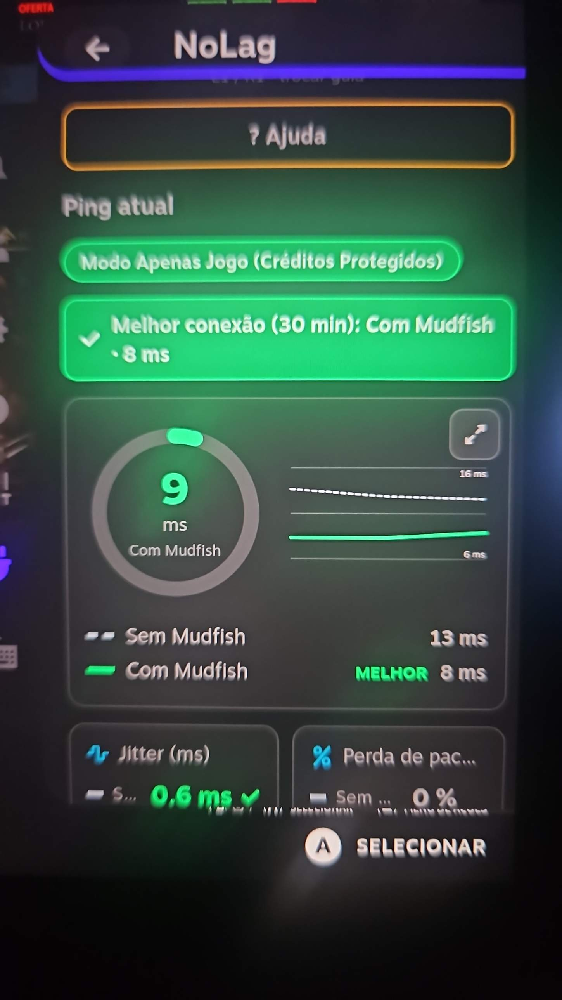
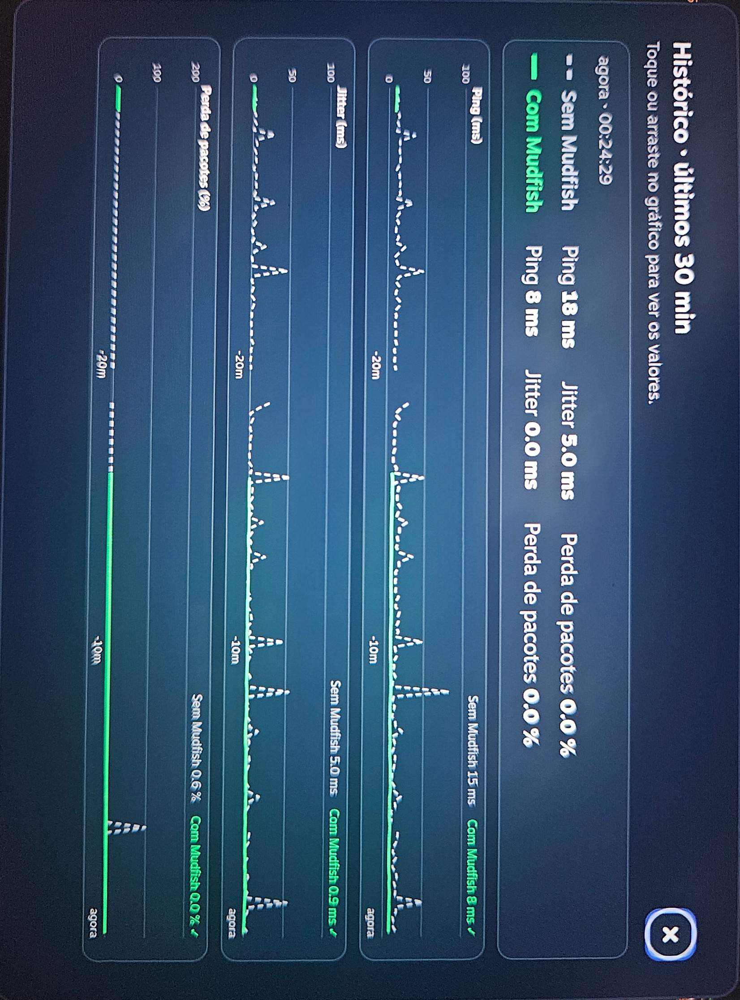
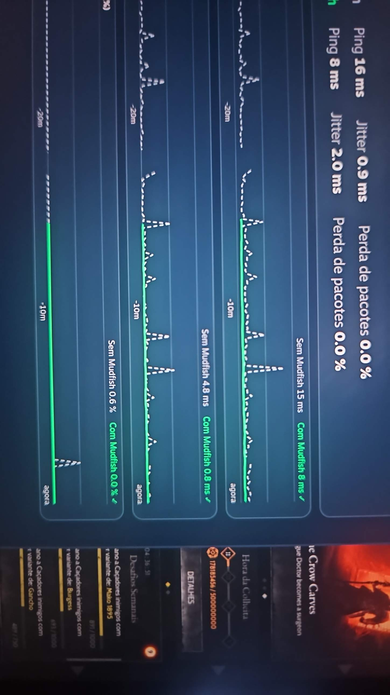

# 🎮 NoLag — Plugin de Decky Loader (SteamOS / Bazzite)

Facilitador de acceso, monitoreo de red y automatización para **SteamOS**, **Steam Deck**, **Legion Go** y handhelds compatibles con **Decky Loader**.

El plugin tiene **dos módulos independientes**, para mantener el control simple, predecible y seguro:

- 📶 **Wi-Fi:** ajustes locales de red (basados en *WiFi Optimizer*), aislados y persistentes. No se deshacen al cerrar juegos, reiniciar la consola ni apagar Mudfish.
- 🌐 **Mudfish:** gestiona el servicio headless (puerto `127.0.0.1:8282`), con telemetría en tiempo real, historial de 30 minutos, comparación *Sin Mudfish vs. Con Mudfish*, destaque de mejor conexión y selector de navegador para la interfaz web.

Idiomas: 🇧🇷 Portugués · 🇺🇸 Inglés · 🇪🇸 Español.

---

## 🔗 Servicio de terceros (Mudfish)

- **Mudfish** es un servicio de terceros y requiere tu propia cuenta y créditos/plan.
- Sitio oficial: [mudfish.net](https://mudfish.net/) · Descargas: [mudfish.net/releases](https://mudfish.net/releases/)
- Login, ítems de juego, región, nodos y **Full VPN** se configuran en el panel nativo: `http://127.0.0.1:8282`.

> ⚠️ **Aviso sobre la versión `5.xx`:** por ahora, el plugin puede instalar o mostrar la base `5.xx` del núcleo en algunos escenarios. **Al actualizar el plugin/núcleo, el funcionamiento es normal.**

---

## 🧩 Qué hace cada sección

### 📊 Panel
Anillo de ping actual, comparación *Sin Mudfish* vs. *Con Mudfish*, mini-tarjetas de **Jitter** y **Pérdida de paquetes** (✓ en el menor valor), franja **Mejor conexión (30 min)** y botón de expansión para el historial en pantalla completa.

### 📶 Wi-Fi
Organizado en *Acciones rápidas*, *Optimizaciones*, *Streaming* y *Avanzado*. Estabiliza la conexión local sin depender de Mudfish.

### 🌐 Mudfish
- Estado en 3 pasos; instalar, actualizar o **desinstalar** el núcleo (con confirmación).
- Abre el panel web y trae el botón de ayuda (`?`): usa **Ítem de Juego** cuando hay un servidor dedicado en la región deseada, y **Full VPN** cuando no hay ítem/ruta para esa región (ej.: dirigir a São Paulo).

### ⚙️ Conf
Idioma, perfiles por juego (Wi-Fi), "Mantener encendido al reiniciar" y el **selector de navegador** del panel (navegador de Steam o navegadores instalados detectados en el sistema).

---

## 🛡️ Protección de créditos

- 💰 Mudfish **siempre inicia apagado** y se **cierra automáticamente al salir de cualquier juego**, evitando gasto de créditos fuera de la partida.
- 🚀 Al encender Mudfish, el panel se abre en el navegador elegido (el panel solo termina de iniciar una vez abierto).
- ⏸️ Con **Full VPN** activo, mantén pausadas las descargas en segundo plano.

---

## 📸 Capturas de pantalla

### Panel en Modo Juego (QAM)
Mejor conexión de los últimos 30 minutos, anillo de ping, gráfico comparativo y mini-tarjetas de Jitter y Pérdida:

### Historial en pantalla completa (últimos 30 minutos)
Ping, Jitter y Pérdida de paquetes, *Sin Mudfish* vs. *Con Mudfish*:

---

## 💬 Opinión personal de uso

En mi caso, aunque el plugin no siempre muestre una mejora enorme en el número bruto de ping, el gráfico deja claro que **ya no tengo variaciones bruscas de conexión**. Mi problema era una inestabilidad de red que aparecía de vez en cuando y causaba micro-tirones — e irónicamente justo en los momentos críticos de la partida, como muestran los huecos y oscilaciones del gráfico. Con el uso continuo y la ruta estabilizada, **ya no tengo esos problemas**.

---

## 🗺️ Roadmap

- ✅ Dos módulos independientes (Wi-Fi y Mudfish), en PT, EN y ES.
- ✅ Comparación *Sin vs. Con Mudfish*, mejor conexión e historial interactivo de 30 minutos.
- ✅ Full VPN con guía bajo demanda (`?`), desinstalación limpia y selector de navegador mediante acceso directo en Modo Juego.
- 🚧 Refinar el inicio en pantalla completa/resolución y el diseño de control de navegación web en navegadores externos.
- 🔮 Nuevos ajustes en el historial (ventana configurable, controles extra) y compatibilidad continua con SteamOS.
