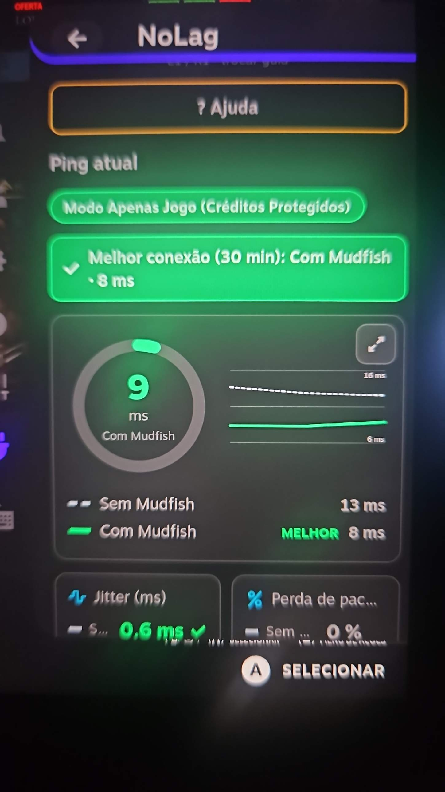
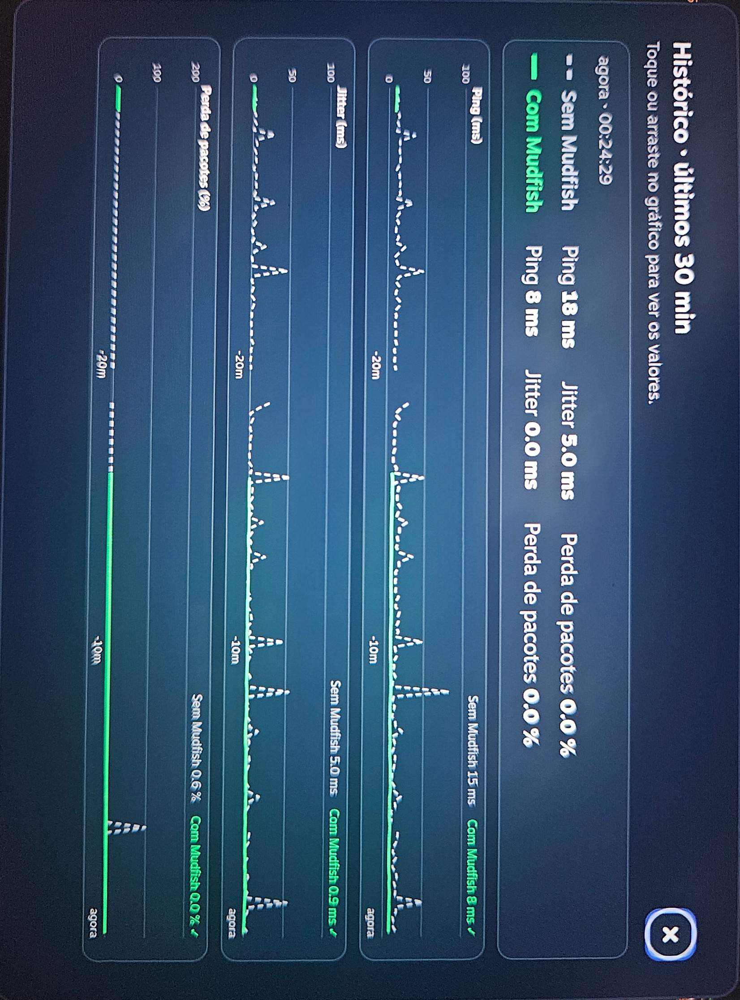
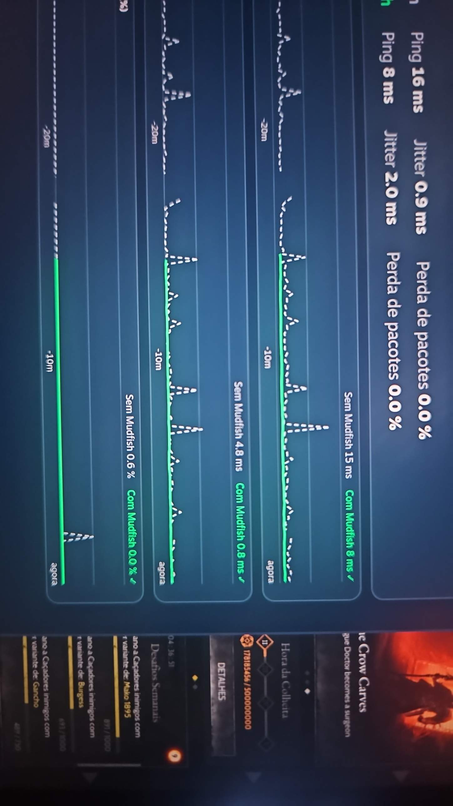

# 🎮 NoLag — Plugin do Decky Loader (SteamOS / Bazzite)

Facilitador de acesso, monitoramento de rede e automação para **SteamOS**, **Steam Deck**, **Legion Go** e handhelds compatíveis com o **Decky Loader**.

O plugin tem **dois módulos independentes**, para manter o controle simples, previsível e seguro:

- 📶 **Wi-Fi:** ajustes locais de rede (baseados no *WiFi Optimizer*), isolados e persistentes. Não são desfeitos ao fechar jogos, reiniciar o console ou desligar o Mudfish.
- 🌐 **Mudfish:** gerencia o serviço headless (porta `127.0.0.1:8282`), com telemetria em tempo real, histórico de 30 minutos, comparativo *Sem Mudfish vs. Com Mudfish*, destaque de melhor conexão e seletor de navegador para a interface web.

Idiomas: 🇧🇷 Português · 🇺🇸 Inglês · 🇪🇸 Espanhol.

---

## 🔗 Serviço de terceiros (Mudfish)

- O **Mudfish** é um serviço de terceiros e exige conta própria e créditos/plano do usuário.
- Site oficial: [mudfish.net](https://mudfish.net/) · Downloads: [mudfish.net/releases](https://mudfish.net/releases/)
- Login, itens de jogo, região, nós e **Full VPN** são configurados no painel nativo: `http://127.0.0.1:8282`.

> ⚠️ **Aviso sobre a versão `5.xx`:** até o momento, o plugin pode instalar ou mostrar a base `5.xx` do núcleo em alguns cenários. **Ao atualizar o plugin/núcleo, o funcionamento ocorre normalmente.**

---

## 🧩 O que cada seção faz

### 📊 Painel
Anel de ping atual, comparativo *Sem Mudfish* vs. *Com Mudfish*, mini-cartões de **Jitter** e **Perda de pacotes** (✓ no menor valor), faixa **Melhor conexão (30 min)** e botão de expansão para o histórico em tela cheia.

### 📶 Wi-Fi
Organizado em *Ações rápidas*, *Otimizações*, *Streaming* e *Avançado*. Estabiliza a conexão local sem depender do Mudfish.

### 🌐 Mudfish
- Status em 3 passos; instalar, atualizar ou **desinstalar** o núcleo (com confirmação).
- Abre o painel web e traz o botão de dica (`?`): use **Item de Jogo** quando há servidor dedicado na região desejada, e **Full VPN** quando não há item/rota para a região (ex.: direcionar para São Paulo).

### ⚙️ Conf
Idioma, perfis por jogo (Wi-Fi), "Manter ligado ao reiniciar" e o **seletor de navegador** do painel (navegador do Steam ou navegadores instalados detectados no sistema).

---

## 🛡️ Proteção de créditos

- 💰 O Mudfish **inicia sempre desligado** e é **encerrado automaticamente ao sair de qualquer jogo**, evitando gasto de créditos fora da partida.
- 🚀 Ao ligar o Mudfish, o painel abre no navegador escolhido (o painel só termina de iniciar depois de aberto).
- ⏸️ Com o **Full VPN** ativo, mantenha downloads em segundo plano pausados.

---

## 📸 Capturas de tela

### Painel no Modo Jogo (QAM)
Melhor conexão nos últimos 30 minutos, anel de ping, gráfico comparativo e mini-cartões de Jitter e Perda:

### Histórico em tela cheia (últimos 30 minutos)
Ping, Jitter e Perda de pacotes, *Sem Mudfish* vs. *Com Mudfish*:

---

## 💬 Opinião pessoal de uso

No meu caso, apesar de o plugin nem sempre mostrar um ganho gigantesco no número bruto de ping, o gráfico deixa claro que **deixei de ter variação brusca de conexão**. Meu problema era uma instabilidade de rede de tempos em tempos, que causava micro-travadas — e, ironicamente, justo nos momentos críticos da partida, como mostram as lacunas e oscilações no gráfico. Com o uso contínuo e a rota estabilizada, **não tenho mais esses problemas**.

---

## 🗺️ Roadmap

- ✅ Dois módulos independentes (Wi-Fi e Mudfish), em PT, EN e ES.
- ✅ Comparativo *Sem vs. Com Mudfish*, melhor conexão e histórico interativo de 30 minutos.
- ✅ Full VPN com guia sob demanda (`?`), desinstalação limpa e seletor de navegador via atalho no Modo Jogo.
- 🚧 Refinar a abertura em tela cheia/resolução e o layout de controle de navegação web nos navegadores externos.
- 🔮 Novos ajustes no histórico (janela configurável, controles extras) e compatibilidade contínua com o SteamOS.
